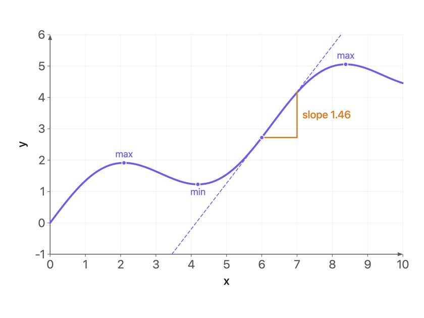
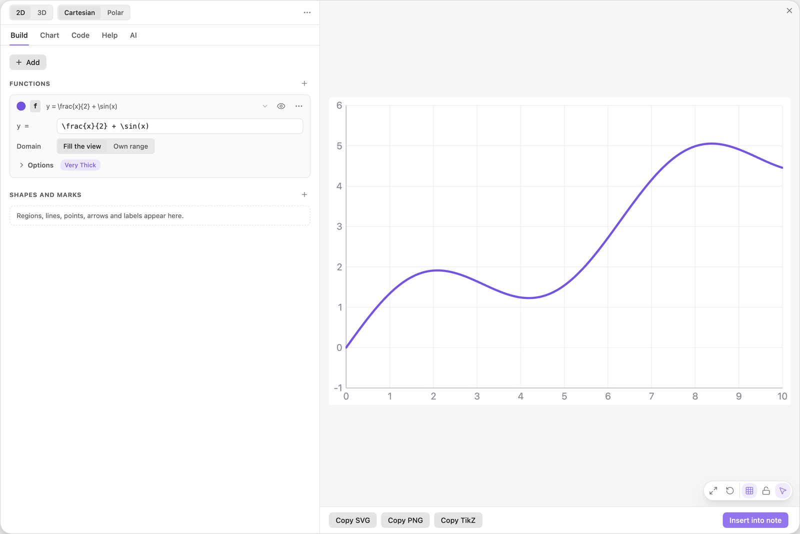
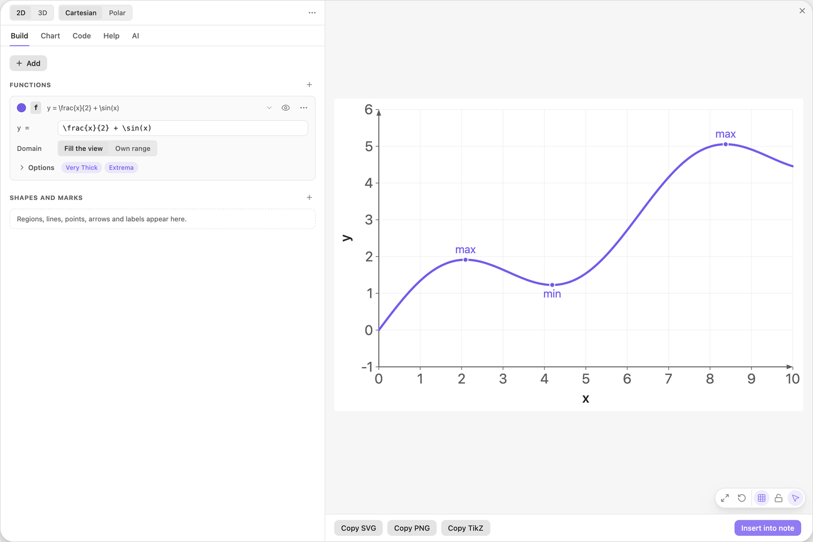
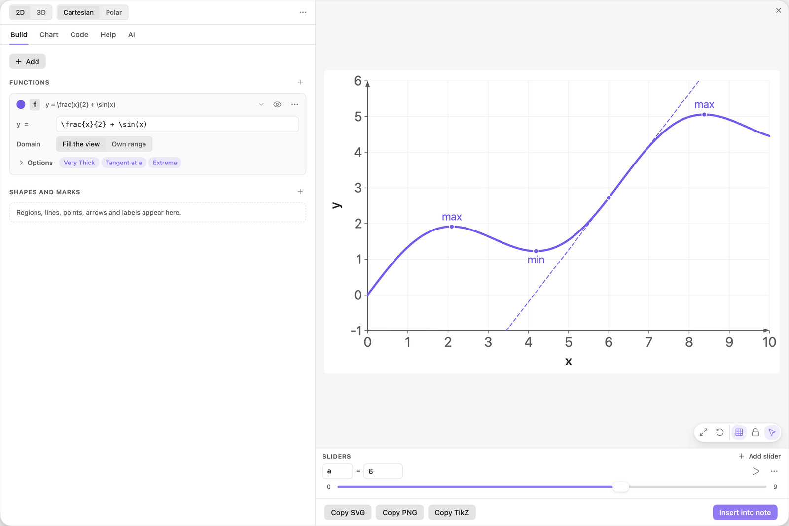
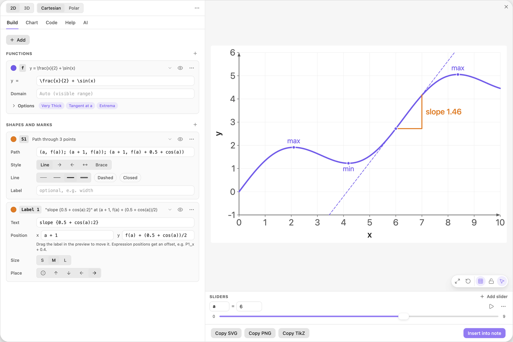

<!-- Generated by scripts/media/build-guides.mjs from src/guides. Do not edit. -->

# Tangents and extrema

[All guides](README.md) · Calculus · Core · about 3 minutes

Mark the turning points of a curve, roll a tangent along it with a slider and print its slope.

<p align="center"></p>

**What you can do afterwards**

- Mark local maxima and minima
- Put a tangent on a slider
- Print a live slope in a label

**Read first:** [Sliders that move the picture](sliders.md)

## 1. Plot the function

Write the window, then the function in LaTeX between dollars: a wave that climbs, with two crests and a trough in view.

The chart in words:

```easy-tikz
show x from 0 to 10 and y from -1 to 6
size 12 x 8
axes on the edges
with a grid
plot $f(x) = \frac{x}{2} + \sin(x)$ in purple, very thick
```



## 2. Mark the extrema

Add `with its extrema` to the plot line. The chart finds every local maximum and minimum in view and labels it.

The chart gets these lines:

```easy-tikz
plot $f(x) = \frac{x}{2} + \sin(x)$ in purple, very thick, with its extrema
```



## 3. Put a tangent on a slider

`with its tangent at a` draws the tangent where x is the slider `a`. Press play: the tangent rolls along the curve and lies flat at each extremum.

The chart gets these lines:

```easy-tikz
slider a from 0 to 9, starting at 6
plot $f(x) = \frac{x}{2} + \sin(x)$ in purple, very thick, with its tangent at a and its extrema
```



> **Tip:** `with its tangent at max2` puts it on the second maximum instead.

## 4. Print the slope

The slope of f at `a` is `0.5 + cos(a)`. A line one unit across and that far up draws the slope triangle, and the label prints the value.

The chart gets these lines:

```easy-tikz
draw a line from (a, f(a)) to (a + 1, f(a)) to (a + 1, f(a) + 0.5 + cos(a)) in orange, thick
write "slope {0.5 + cos(a):2}" at (a + 1, f(a) + (0.5 + cos(a))/2) in orange, right
```



> **Tip:** The chart does not differentiate: for another function, type its derivative yourself.

## The finished chart

Paste this block into a note to get the finished chart of this guide. Click the chart in the note to open it in the editor.

<details>
<summary>The chart as an easy-tikz block</summary>

```easy-tikz
show x from 0 to 10 and y from -1 to 6
size 12 x 8
axes on the edges
with a grid
slider a from 0 to 9, starting at 6
plot $f(x) = \frac{x}{2} + \sin(x)$ in purple, very thick, with its tangent at a and its extrema
draw a line from (a, f(a)) to (a + 1, f(a)) to (a + 1, f(a) + 0.5 + cos(a)) in orange, thick
write "slope {0.5 + cos(a):2}" at (a + 1, f(a) + (0.5 + cos(a))/2) in orange, right
```

</details>

## Next guides

- [From secant to tangent](secant-tangent.md): Shrink the gap h between two points of a curve and watch the secant through them turn into the tangent.
- [An area that grows with a slider](area-accumulation.md): Shade the area under a curve up to a slider and draw the function that adds it up.

[All guides](README.md)
