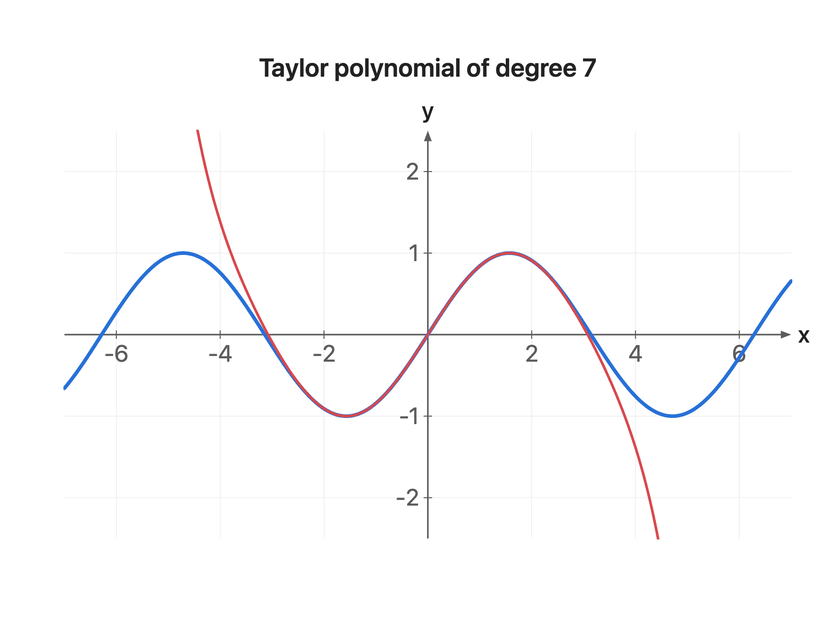
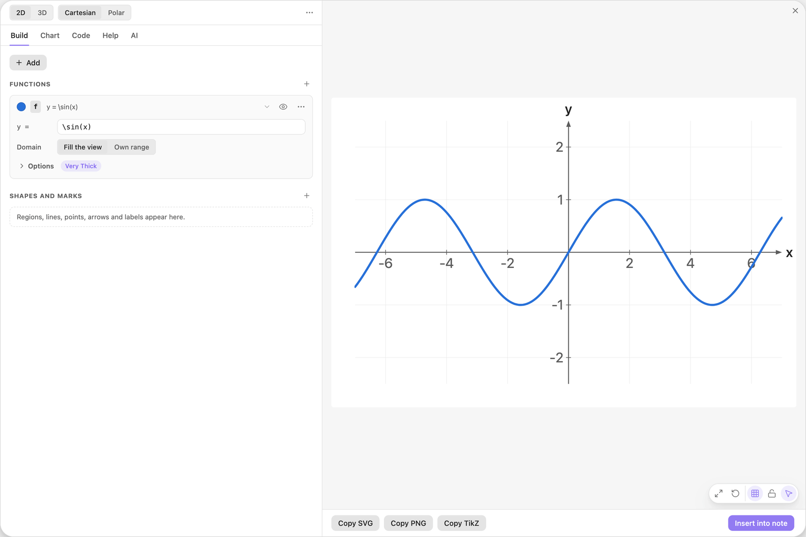
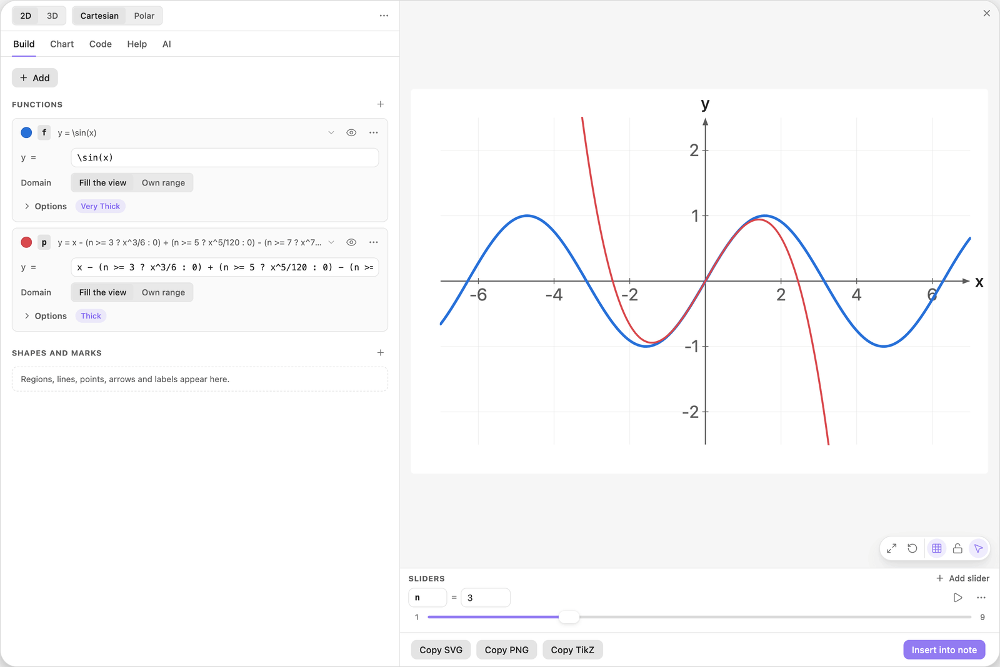
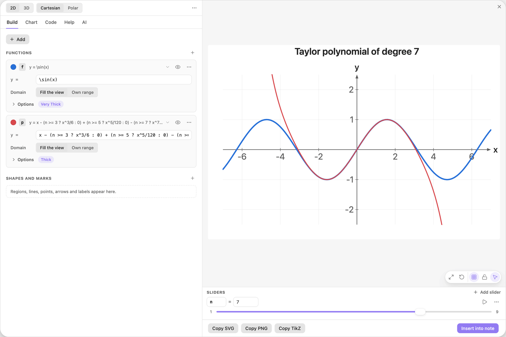

<!-- Generated by scripts/media/build-guides.mjs from src/guides. Do not edit. -->

# Taylor polynomials of sin(x)

[All guides](README.md) · Showcase · Advanced · about 2 minutes

Raise the degree with a slider and watch the polynomial hug the sine over a wider and wider range.

<p align="center"></p>

**What you can do afterwards**

- Switch the terms of a formula on and off with a slider
- Compare a function with its approximation

## 1. Plot the sine

Start with `f(x) = \sin(x)`.

The chart in words:

```easy-tikz
show x from -7 to 7 and y from -2.5 to 2.5
size 12 x 8
axes in the middle
with a grid
plot $f(x) = \sin(x)$ in blue, very thick
```



## 2. Add the polynomial with a slider

Each term counts only from its degree on: `n >= 3 ? x^3/6 : 0` is the cube term when `n` is 3 or more, else 0.

The chart gets these lines:

```easy-tikz
slider n from 1 to 9, starting at 3, in steps of 2
plot p(x) = x - (n >= 3 ? x^3/6 : 0) + (n >= 5 ? x^5/120 : 0) - (n >= 7 ? x^7/5040 : 0) + (n >= 9 ? x^9/362880 : 0) in red, thick
```



## 3. Raise the degree

Drag `n` up, or press play. Each new term holds the curve to the sine a little further out.

The chart gets these lines:

```easy-tikz
title Taylor polynomial of degree {n}
slider n from 1 to 9, starting at 7, in steps of 2
```



## The finished chart

Paste this block into a note to get the finished chart of this guide. Click the chart in the note to open it in the editor.

<details>
<summary>The chart as an easy-tikz block</summary>

```easy-tikz
show x from -7 to 7 and y from -2.5 to 2.5
size 12 x 8
axes in the middle
with a grid
title Taylor polynomial of degree {n}
slider n from 1 to 9, starting at 7, in steps of 2
plot $f(x) = \sin(x)$ in blue, very thick
plot p(x) = x - (n >= 3 ? x^3/6 : 0) + (n >= 5 ? x^5/120 : 0) - (n >= 7 ? x^7/5040 : 0) + (n >= 9 ? x^9/362880 : 0) in red, thick
```

</details>

## Next guides

- [Estimate an area with Riemann sums](riemann-sums.md): Fill an area with rectangles, watch their sum approach the integral, then try trapezoids and middle sums.

[All guides](README.md)
