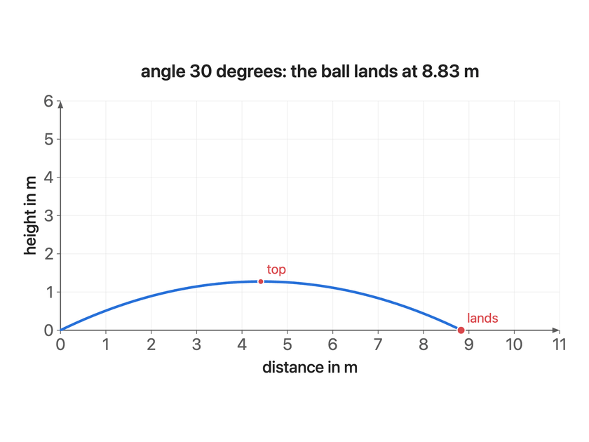
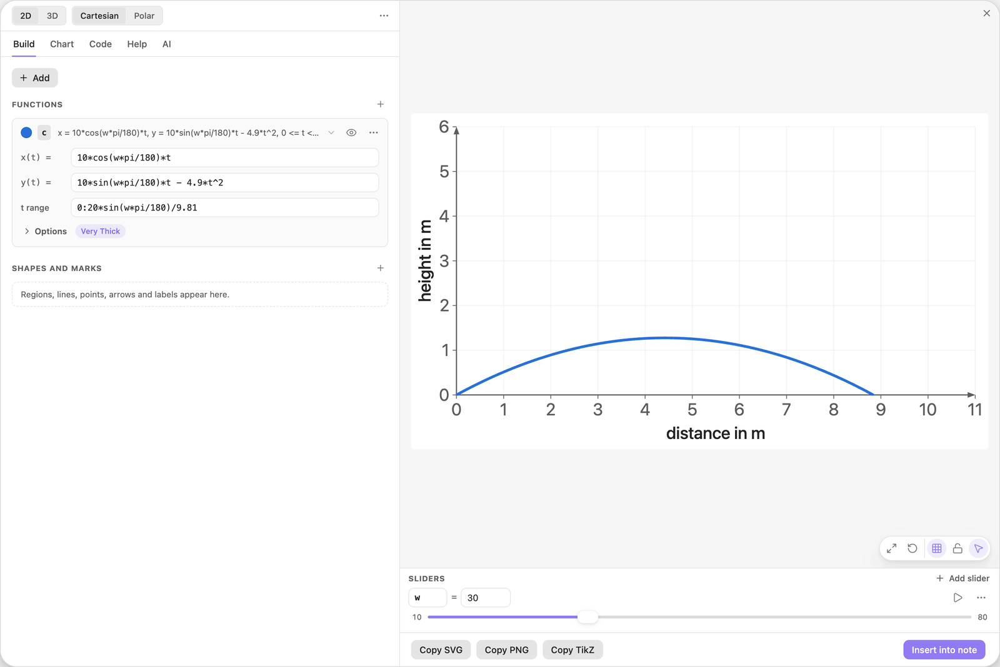
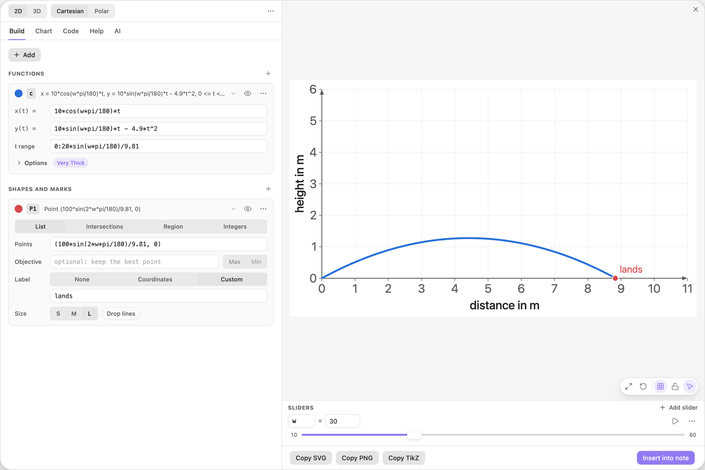
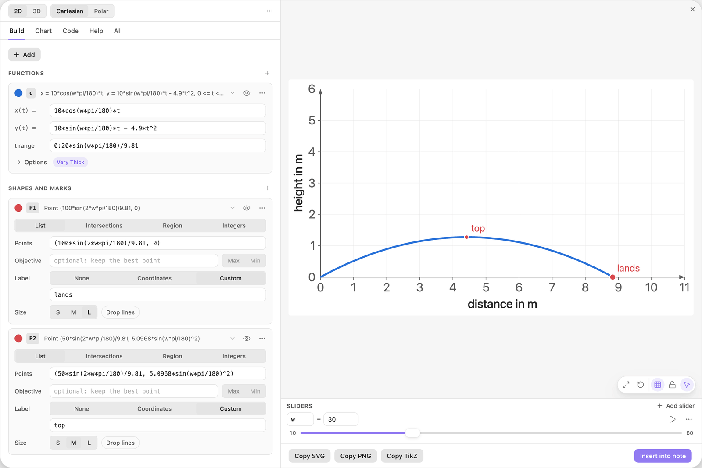
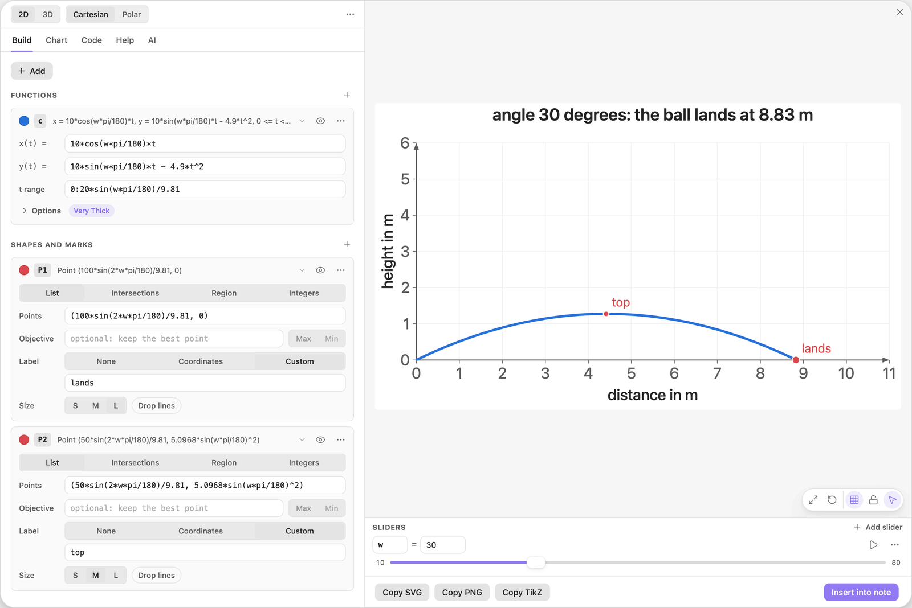

<!-- Generated by scripts/media/build-guides.mjs from src/guides. Do not edit. -->

# A throw at an angle

[All guides](README.md) · Showcase · Core · about 2 minutes

Throw a ball at 10 m/s and change the angle: the path, its top and where it lands move together.

<p align="center"></p>

**What you can do afterwards**

- Plot a path in t with a slider in it
- Mark points worked out from the slider
- Find the angle that throws farthest

## 1. Plot the path of the ball

The path is a curve in the time `t`: x and y of the ball, for the angle `w` on the slider.

The chart in words:

```easy-tikz
show x from 0 to 11 and y from 0 to 6
size 12 x 7
axes on the edges
with a grid
xlabel distance in m
ylabel height in m
slider w from 10 to 80, starting at 30
plot c(t) = (10*cos(w*pi/180)*t, 10*sin(w*pi/180)*t - 4.9*t^2) for t from 0 to 20*sin(w*pi/180)/9.81 in blue, very thick
```



## 2. Mark where it lands

The landing point is a formula of `w` too, so it follows the path.

The chart gets these lines:

```easy-tikz
mark (100*sin(2*w*pi/180)/9.81, 0), large, labelled "lands"
```



## 3. Mark the top

The highest point sits halfway, at a height that grows with the angle.

The chart gets these lines:

```easy-tikz
mark (50*sin(2*w*pi/180)/9.81, 5.0968*sin(w*pi/180)^2), labelled "top"
```



## 4. Find the farthest throw

The title prints the distance. Drag `w`: the ball flies farthest at 45 degrees.

The chart gets these lines:

```easy-tikz
title angle {w} degrees: the ball lands at {100*sin(2*w*pi/180)/9.81:2} m
```



## The finished chart

Paste this block into a note to get the finished chart of this guide. Click the chart in the note to open it in the editor.

<details>
<summary>The chart as an easy-tikz block</summary>

```easy-tikz
show x from 0 to 11 and y from 0 to 6
size 12 x 7
axes on the edges
with a grid
title angle {w} degrees: the ball lands at {100*sin(2*w*pi/180)/9.81:2} m
xlabel distance in m
ylabel height in m
slider w from 10 to 80, starting at 30
plot c(t) = (10*cos(w*pi/180)*t, 10*sin(w*pi/180)*t - 4.9*t^2) for t from 0 to 20*sin(w*pi/180)/9.81 in blue, very thick
mark (100*sin(2*w*pi/180)/9.81, 0), large, labelled "lands"
mark (50*sin(2*w*pi/180)/9.81, 5.0968*sin(w*pi/180)^2), labelled "top"
```

</details>

## Next guides

- [Parametric and polar curves](parametric-polar.md): Trace a curve from x(t) and y(t), then switch to polar and grow a rose whose petals a slider counts.

[All guides](README.md)
