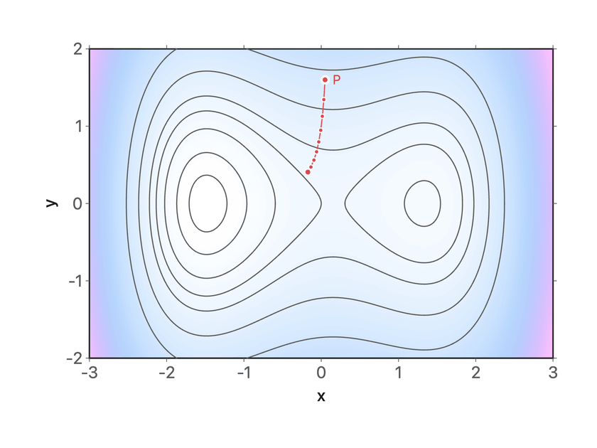
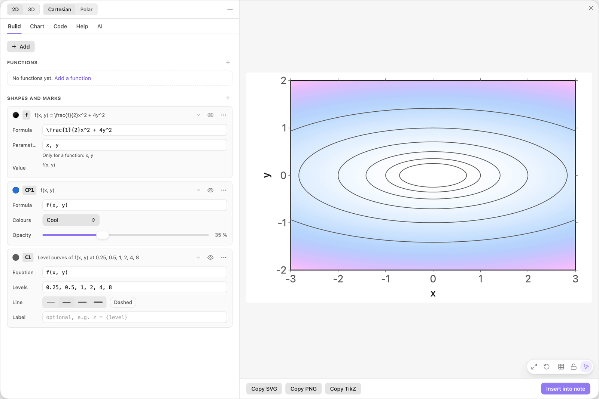
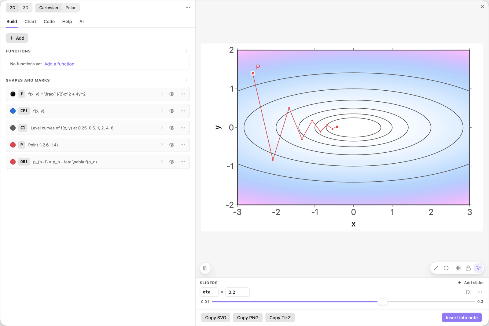
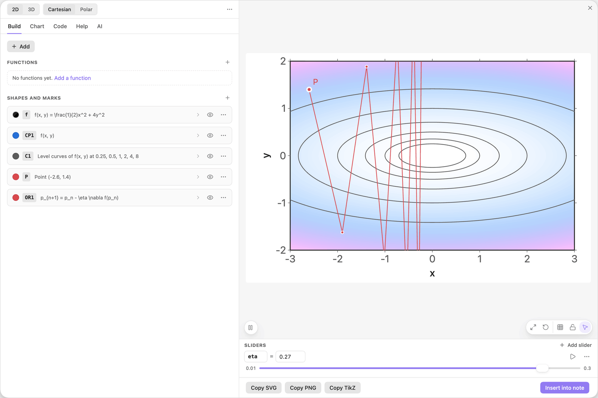
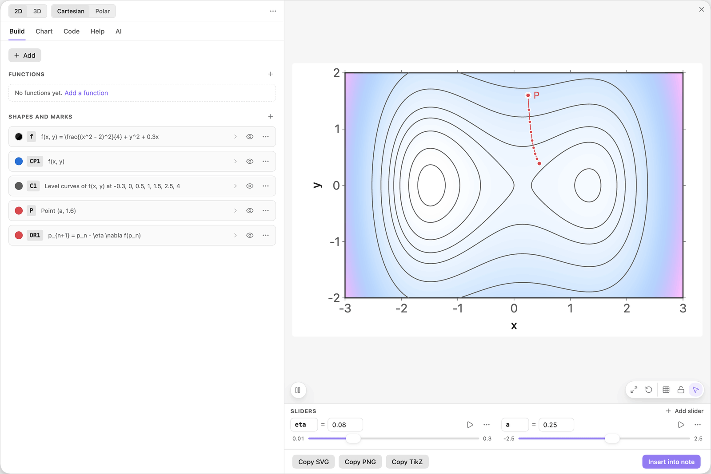
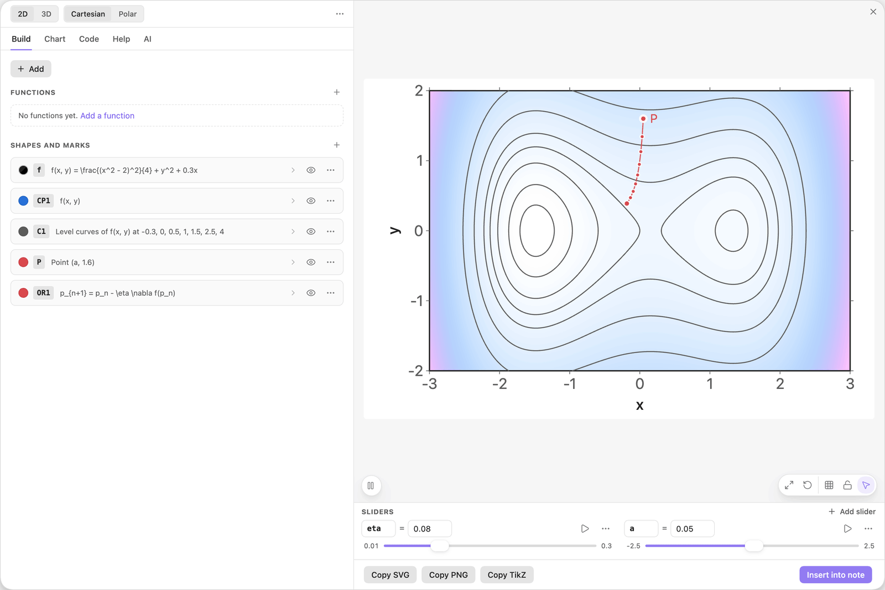

<!-- Generated by scripts/media/build-guides.mjs from src/guides. Do not edit. -->

# Gradient descent in a bowl and two valleys

[All guides](README.md) · Showcase · Advanced · about 3 minutes

Walk downhill with the step size on a slider: a step too large zigzags away, and the start picks the valley you end in.

<p align="center"></p>

**What you can do afterwards**

- Draw gradient descent as a path that draws itself
- Find a step size that is too large
- See the start decide the minimum

## 1. Draw a bowl

`let` names f(x, y) = x²/2 + 4y², a long bowl: steep in y, flat in x. Its level curves and a light heat map show the shape.

The chart in words:

```easy-tikz
show x from -3 to 3 and y from -2 to 2
size 12 x 8
equal scale
let $f(x, y) = \frac{1}{2}x^2 + 4y^2$
colour the plane by $f(x, y)$ in cool, opacity 0.35
draw the level curves of f(x, y) at 0.25, 0.5, 1, 2, 4 and 8 in gray
```



## 2. Walk downhill from P

Each step goes against the gradient `\nabla f`, times the step size `eta`. `traced` lets the path draw itself: it zigzags across the steep side and settles at 0.

The chart gets these lines:

```easy-tikz
slider eta from 0.01 to 0.3, starting at 0.2
P: mark (-2.6, 1.4), large, labelled "P"
draw the orbit of $p_{n+1} = p_n - \eta \nabla f(p_n)$, $p_0 = P$, 25 steps, traced
```



> **Tip:** In the editor, drag P: the path starts again from there.

## 3. Make the step too large

Drag `eta` past 0.25. Each step now jumps further across the bowl than the one before: the zigzag grows and the path leaves the chart.

The chart gets these lines:

```easy-tikz
slider eta from 0.01 to 0.3, starting at 0.27
```



## 4. Go to two valleys

This f has a deep valley on the left, a shallow one on the right and a ridge between them at x = 0.15. P starts right of the ridge and finds the shallow valley.

The chart gets these lines:

```easy-tikz
slider eta from 0.01 to 0.3, starting at 0.08
slider a from -2.5 to 2.5, starting at 0.25
let $f(x, y) = \frac{(x^2 - 2)^2}{4} + y^2 + 0.3x$
draw the level curves of f(x, y) at -0.3, 0, 0.5, 1, 1.5, 2.5 and 4 in gray
P: mark (a, 1.6), large, labelled "P"
```



## 5. Let the start pick the valley

Drag `a` to move P across the ridge. Left of 0.15 the path runs into the deep valley instead: where you start decides which minimum you find.

The chart gets these lines:

```easy-tikz
slider a from -2.5 to 2.5, starting at 0.05
```



## The finished chart

Paste this block into a note to get the finished chart of this guide. Click the chart in the note to open it in the editor.

<details>
<summary>The chart as an easy-tikz block</summary>

```easy-tikz
show x from -3 to 3 and y from -2 to 2
size 12 x 8
equal scale
slider eta from 0.01 to 0.3, starting at 0.08
slider a from -2.5 to 2.5, starting at 0.05
let $f(x, y) = \frac{(x^2 - 2)^2}{4} + y^2 + 0.3x$
colour the plane by $f(x, y)$ in cool, opacity 0.35
draw the level curves of f(x, y) at -0.3, 0, 0.5, 1, 1.5, 2.5 and 4 in gray
P: mark (a, 1.6), large, labelled "P"
draw the orbit of $p_{n+1} = p_n - \eta \nabla f(p_n)$, $p_0 = P$, 25 steps, traced
```

</details>

## Next guides

- [Gradient descent and Newton's method](descent-newton.md): Walk downhill on level curves with gradient descent, take steps that are too long, and find a root with Newton's method.
- [A gradient on level curves](gradient-levels.md): A point moves around the level curves; the level through it and its gradient arrow move along.

[All guides](README.md)
