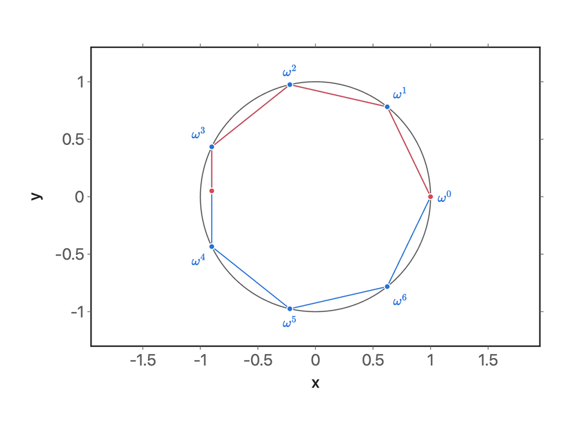
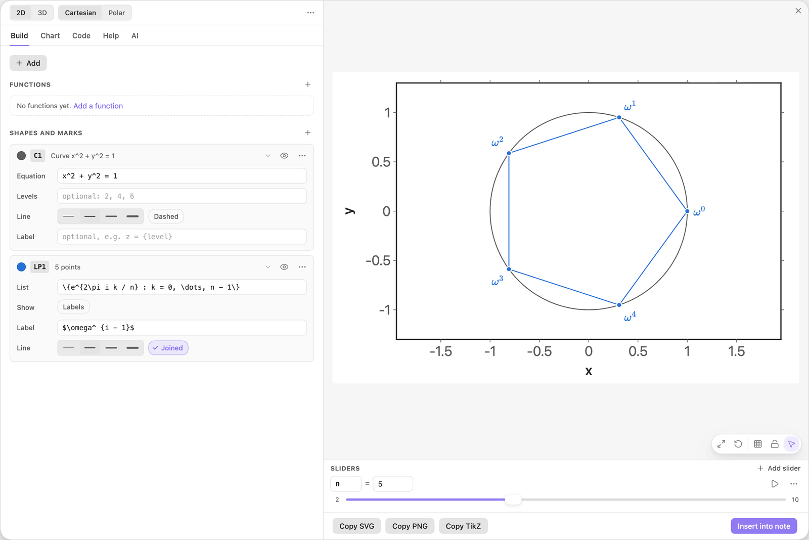
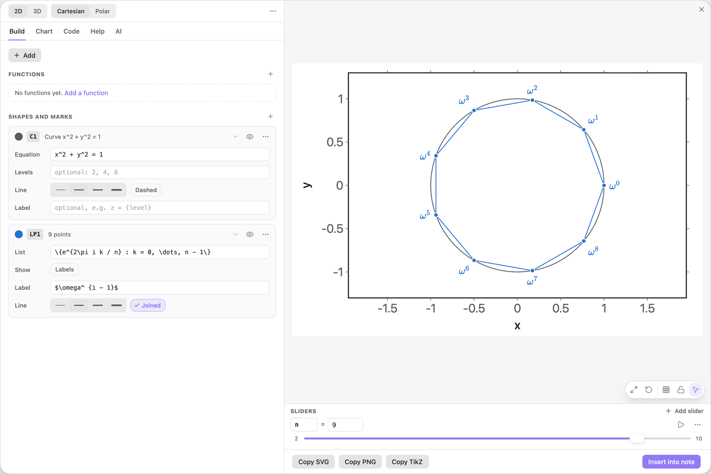
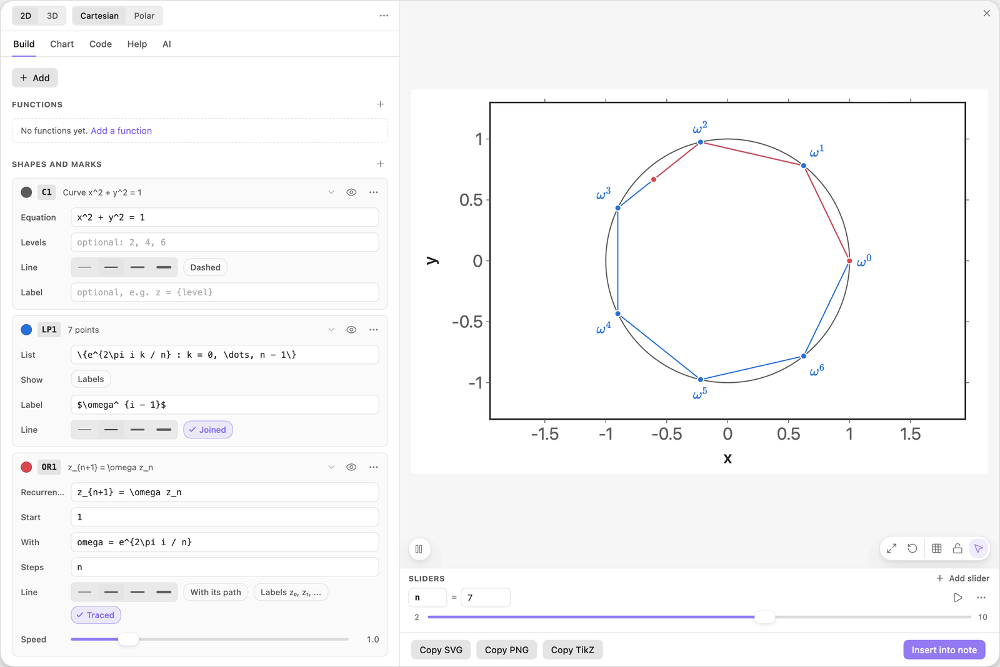
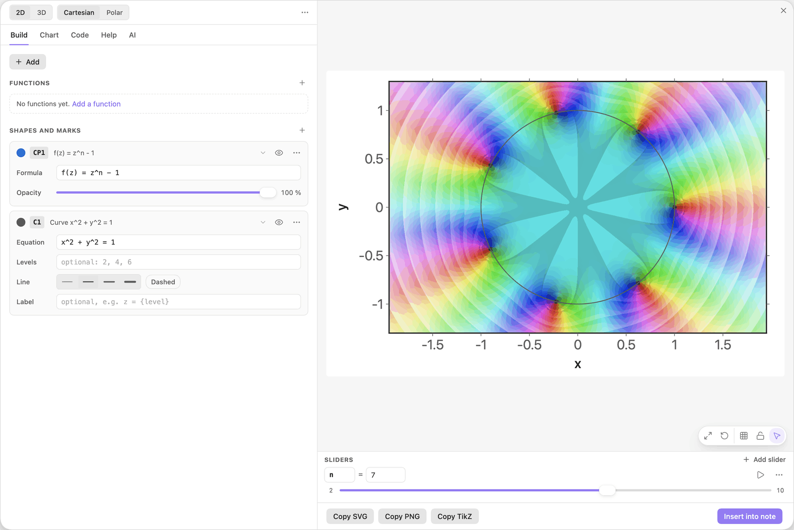

<!-- Generated by scripts/media/build-guides.mjs from src/guides. Do not edit. -->

# Roots of unity on a slider

[All guides](README.md) · Showcase · Core · about 2 minutes

The n numbers with zⁿ = 1 make a regular polygon on the unit circle, and multiplying by ω turns each one to the next.

<p align="center"></p>

**What you can do afterwards**

- Mark a list of complex numbers
- Change their count with a slider
- Trace an orbit that multiplies by ω

## 1. Mark the roots of unity

The n numbers e^(2πik/n) solve zⁿ = 1. `mark the points` takes their list, and `joined` draws the polygon through them. Each one is a power of ω, the first after 1.

The chart in words:

```easy-tikz
show x from -1.95 to 1.95 and y from -1.3 to 1.3
size 12 x 8
equal scale
slider n from 2 to 10, starting at 5, in steps of 1
draw x^2 + y^2 = 1 in gray
mark the points $\{e^{2\pi i k / n} : k = 0, \dots, n - 1\}$ in blue, joined, labelled "$\omega^ {i - 1}$"
```



## 2. Change n with a slider

Drag `n`: the polygon gains corners and comes closer to the circle. ω is always a turn by 1/n of the circle.

The chart gets these lines:

```easy-tikz
slider n from 2 to 10, starting at 9, in steps of 1
```



## 3. Turn by ω, step by step

The orbit of z ↦ ωz from 1 draws itself: each step multiplies by ω and moves the dot one corner on. After n steps it is back at 1.

The chart gets these lines:

```easy-tikz
slider n from 2 to 10, starting at 7, in steps of 1
draw the orbit of $z_{n+1} = \omega z_n$, $z_0 = 1$, $omega = e^{2\pi i / n}$, n steps, traced
```



## 4. Colour the plane by zⁿ - 1

The roots are the zeros of zⁿ - 1, so all colours meet at each of them, on the circle. Drag `n`: there are always n such points.

The chart gets these lines:

```easy-tikz
colour the plane by $f(z) = z^n - 1$
```



## The finished chart

Paste this block into a note to get the finished chart of this guide. Click the chart in the note to open it in the editor.

<details>
<summary>The chart as an easy-tikz block</summary>

```easy-tikz
show x from -1.95 to 1.95 and y from -1.3 to 1.3
size 12 x 8
equal scale
slider n from 2 to 10, starting at 7, in steps of 1
draw x^2 + y^2 = 1 in gray
mark the points $\{e^{2\pi i k / n} : k = 0, \dots, n - 1\}$ in blue, joined, labelled "$\omega^ {i - 1}$"
draw the orbit of $z_{n+1} = \omega z_n$, $z_0 = 1$, $omega = e^{2\pi i / n}$, n steps, traced
```

</details>

## Next guides

- [Complex functions, seen two ways](complex-two-ways.md): A function of z bends a grid in a step you can play, and colours the plane: z², 1/z and e^z, each both ways.
- [Complex numbers and maps](complex-maps.md): Mark complex numbers as points, bend a grid with z ↦ z² and colour the plane by a complex function.

[All guides](README.md)
