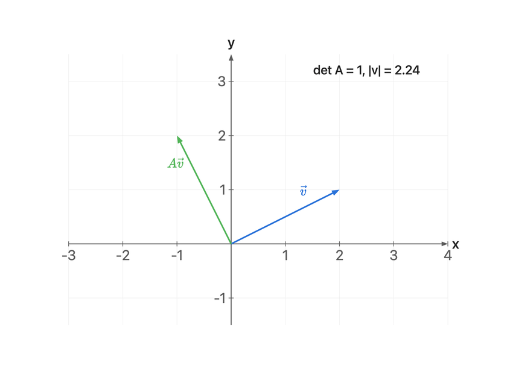
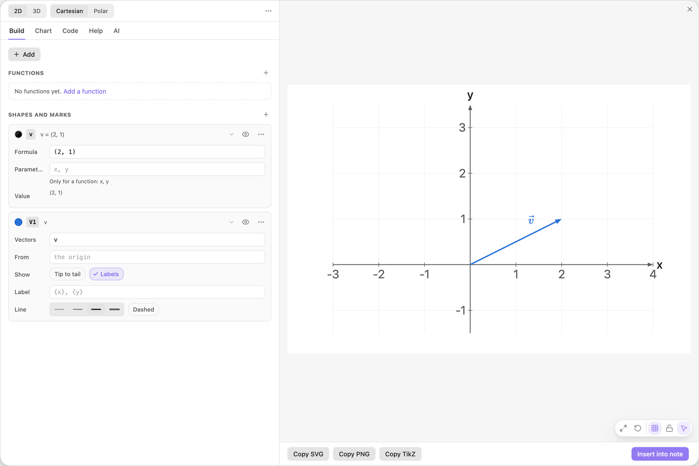
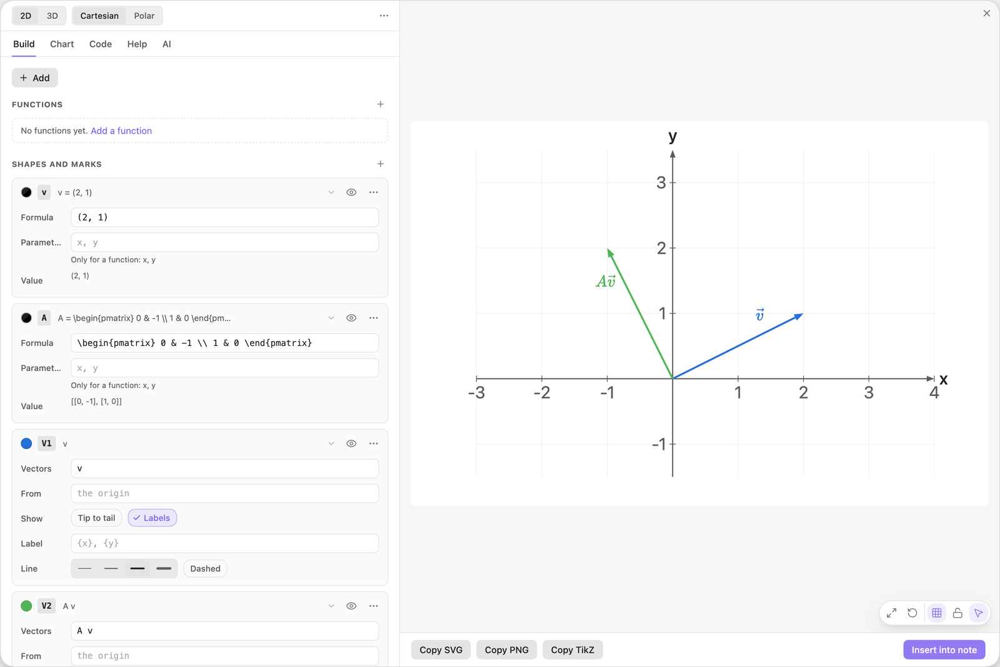
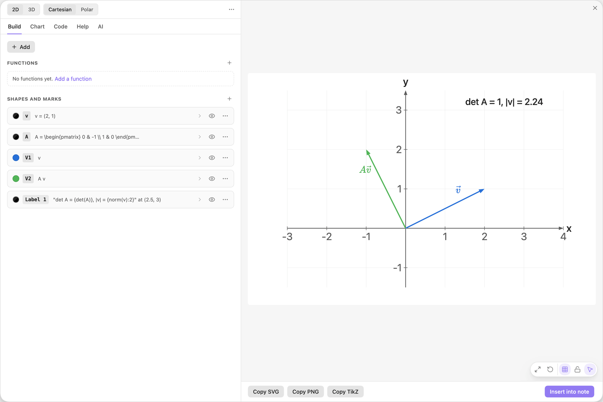
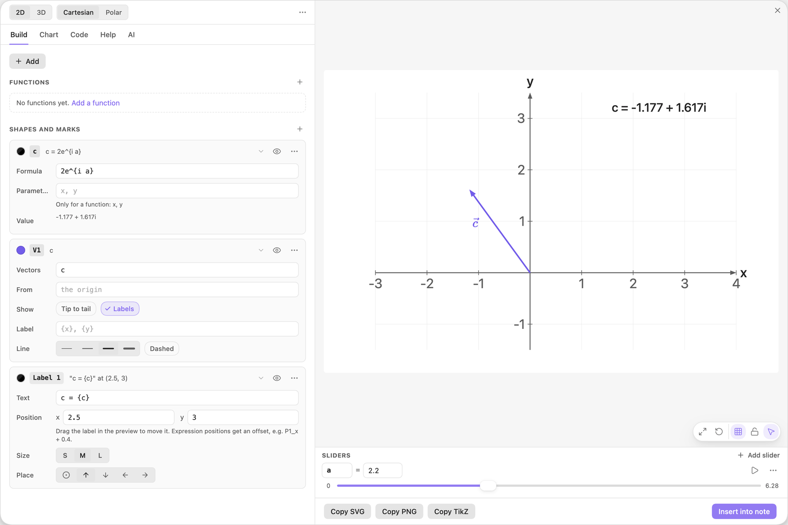

<!-- Generated by scripts/media/build-guides.mjs from src/guides. Do not edit. -->

# Vectors, matrices and complex numbers

[All guides](README.md) · Chart language · Core · about 3 minutes

Give a vector, a matrix or a complex number a name with let, and use it in every line and label.

<p align="center"></p>

**What you can do afterwards**

- Name values with let
- Multiply a matrix and a vector
- Print values in a label
- Put a slider inside a value

**Read first:** [Write formulas as in your notes](formulas.md)

## 1. Name a vector with let

`let v = (2, 1)` names a vector, and every line of the chart can use v. `draw v as an arrow, labelled` draws it from the origin.

The chart in words:

```easy-tikz
show x from -3 to 4 and y from -1.5 to 3.5
size 12 x 8
equal scale
axes in the middle
with a grid
let v = (2, 1)
draw v as an arrow, labelled
```



## 2. Name a matrix and multiply

Write a matrix in LaTeX with `pmatrix`, or plain as `[[0, -1], [1, 0]]`. `A v` is the product: this A turns v a quarter turn.

The chart gets these lines:

```easy-tikz
let $A = \begin{pmatrix} 0 & -1 \\ 1 & 0 \end{pmatrix}$
draw A v as an arrow in green, labelled
```



## 3. Print values in a label

Braces in a label work out any value: `{det(A)}` is the determinant, 1, and `{norm(v):2}` the length of v to two decimals.

The chart gets these lines:

```easy-tikz
write "det A = {det(A)}, |v| = {norm(v):2}" at (2.5, 3)
```



## 4. Put a slider inside a value

`let $c = 2e^{ia}$` is a complex number of length 2 at the angle `a`. Drag `a`: the arrow of c turns round the origin.

The chart gets these lines:

```easy-tikz
slider a from 0 to 6.28, starting at 2.2
let $c = 2e^{i a}$
draw c as an arrow in purple, labelled
write "c = {c}" at (2.5, 3)
```



> **Tip:** A name can hold a function too: `let $f(x, y) = x^2 + 4y^2$`.

## The finished chart

Paste this block into a note to get the finished chart of this guide. Click the chart in the note to open it in the editor.

<details>
<summary>The chart as an easy-tikz block</summary>

```easy-tikz
show x from -3 to 4 and y from -1.5 to 3.5
size 12 x 8
equal scale
axes in the middle
with a grid
let v = (2, 1)
let $A = \begin{pmatrix} 0 & -1 \\ 1 & 0 \end{pmatrix}$
draw v as an arrow, labelled
draw A v as an arrow in green, labelled
write "det A = {det(A)}, |v| = {norm(v):2}" at (2.5, 3)
```

</details>

## Next guides

- [Vectors and arrows](vectors-arrows.md): Name vectors with let, draw them as arrows, add them tip to tail and scale one with a slider.
- [Sums: Taylor and Fourier series](sums-series.md): Write a sum with a slider in its bound: a Taylor polynomial hugs the sine, and turning circles draw a square wave.
- [A matrix moves the plane](matrix-plane.md): Draw the grid and the basis vectors, then let a matrix move the whole plane in a step you can play.

[All guides](README.md)
