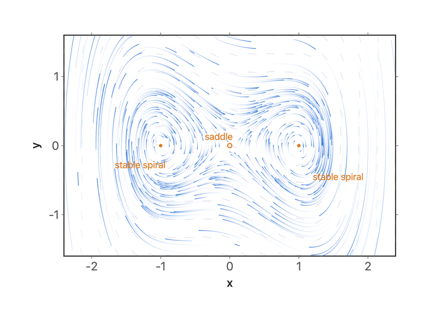
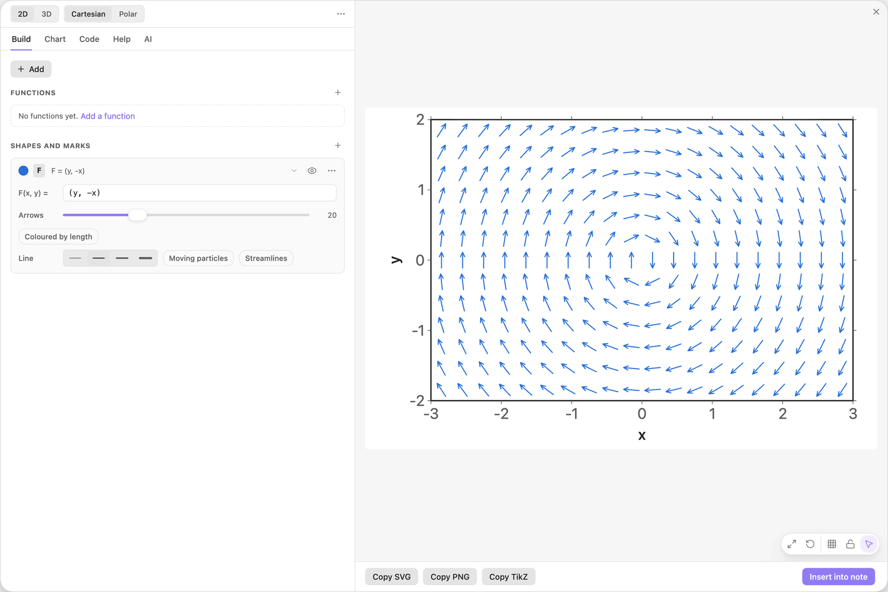
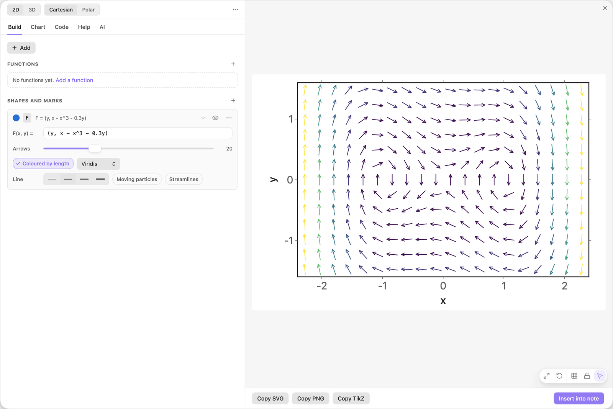
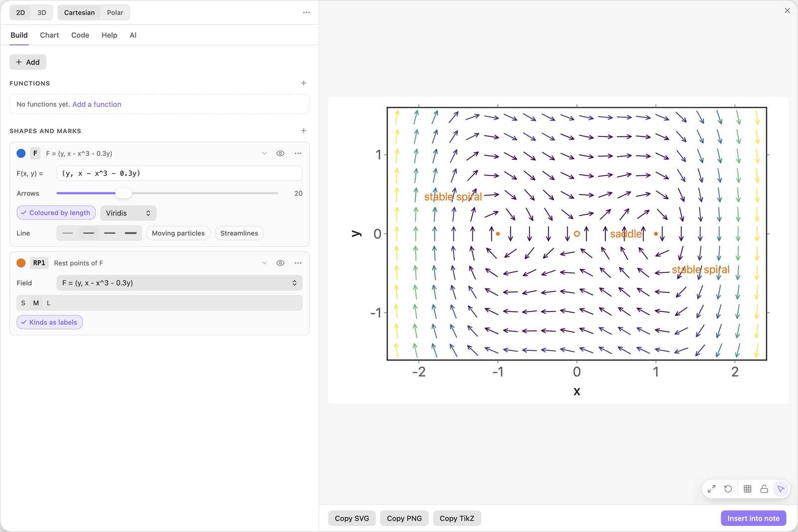
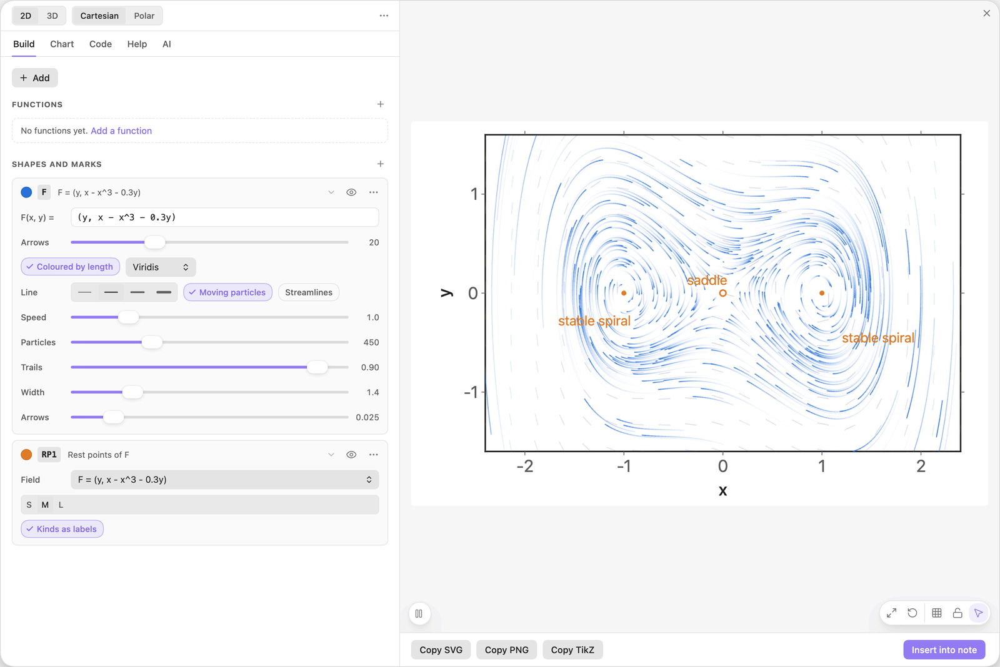
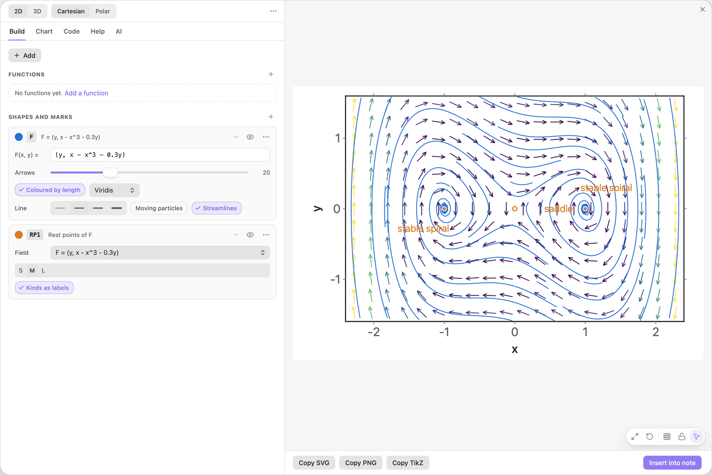

<!-- Generated by scripts/media/build-guides.mjs from src/guides. Do not edit. -->

# Vector fields and rest points

[All guides](README.md) · Dynamics and fractals · Core · about 3 minutes

Draw a vector field, colour it by length, mark its rest points and set particles flowing along it.

<p align="center"></p>

**What you can do afterwards**

- Draw and colour a vector field
- Mark and name its rest points
- Add moving particles or streamlines

## 1. Draw a vector field

`draw the vector field $F(x, y) = (y, -x)$` draws an arrow in the direction of F all over the view. The arrows have one length on screen; these turn round the origin.

The chart in words:

```easy-tikz
show x from -3 to 3 and y from -2 to 2
size 12 x 8
equal scale
draw the vector field $F(x, y) = (y, -x)$
```



## 2. Colour the arrows by length

A field with more going on. `coloured by length` shows where it is strong, in yellow, and weak, in purple.

The chart gets these lines:

```easy-tikz
show x from -2.4 to 2.4 and y from -1.6 to 1.6
draw the vector field $F(x, y) = (y, x - x^3 - 0.3y)$, coloured by length
```



## 3. Mark the rest points

`mark the rest points of F, labelled` finds where F is 0 and names each kind. Filled dots are stable, open ones are not: two stable spirals and a saddle.

The chart gets these lines:

```easy-tikz
mark the rest points of F, labelled
```



## 4. Set particles flowing

`with moving particles` lets dots flow along F at its speed, with short trails. They move in notes and here, and a Pause button stops them.

The chart gets these lines:

```easy-tikz
draw the vector field $F(x, y) = (y, x - x^3 - 0.3y)$, coloured by length, with moving particles
```



## 5. Draw streamlines for print

Paper shows one still frame of the particles. `with streamlines` draws curves along F that the PDF and the LaTeX export keep.

The chart gets these lines:

```easy-tikz
draw the vector field $F(x, y) = (y, x - x^3 - 0.3y)$, coloured by length, with streamlines
```



## The finished chart

Paste this block into a note to get the finished chart of this guide. Click the chart in the note to open it in the editor.

<details>
<summary>The chart as an easy-tikz block</summary>

```easy-tikz
show x from -2.4 to 2.4 and y from -1.6 to 1.6
size 12 x 8
equal scale
draw the vector field $F(x, y) = (y, x - x^3 - 0.3y)$, coloured by length, with moving particles
mark the rest points of F, labelled
```

</details>

## Next guides

- [Solutions of systems in 2D and 3D](systems.md): Draw the path a system of equations takes from a point: predators and prey in the plane, then the Lorenz system in space.
- [A pendulum as a vector field](pendulum-field.md): The angle and the speed of a pendulum as a field with flowing particles: push it with a slider until it swings over the top.
- [Slope fields and solutions](slope-fields.md): Draw the slope field of a differential equation and the solution through a point you move.

[All guides](README.md)
