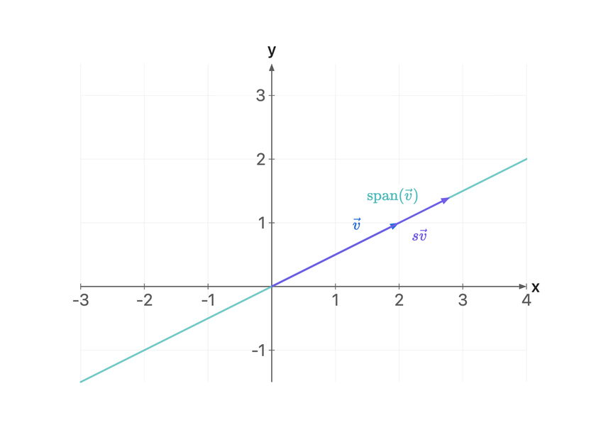
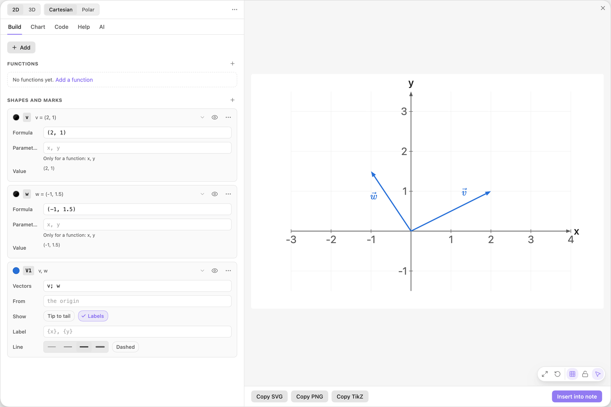
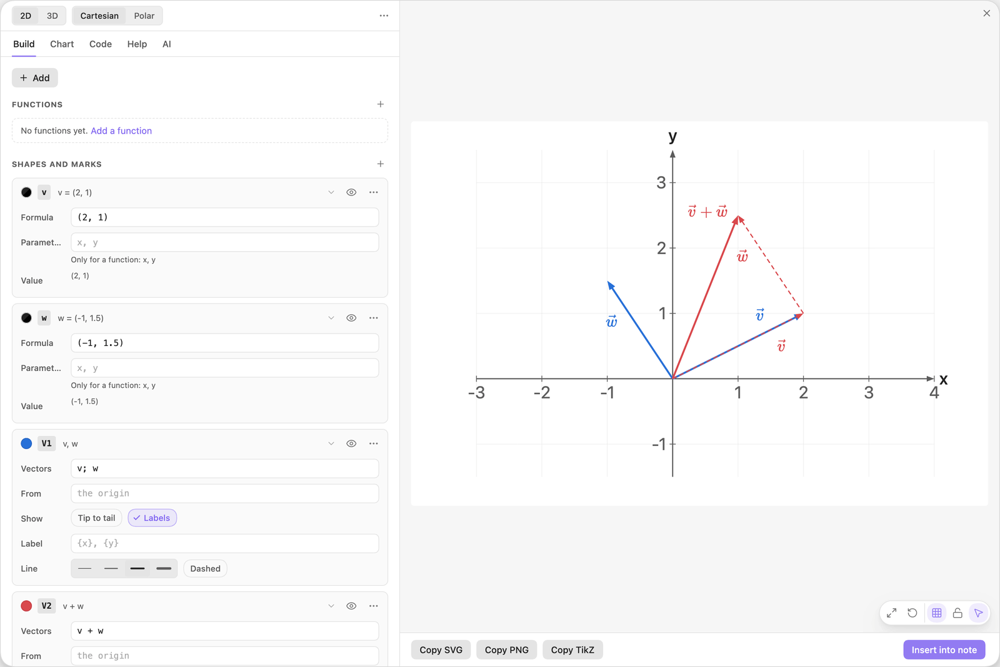
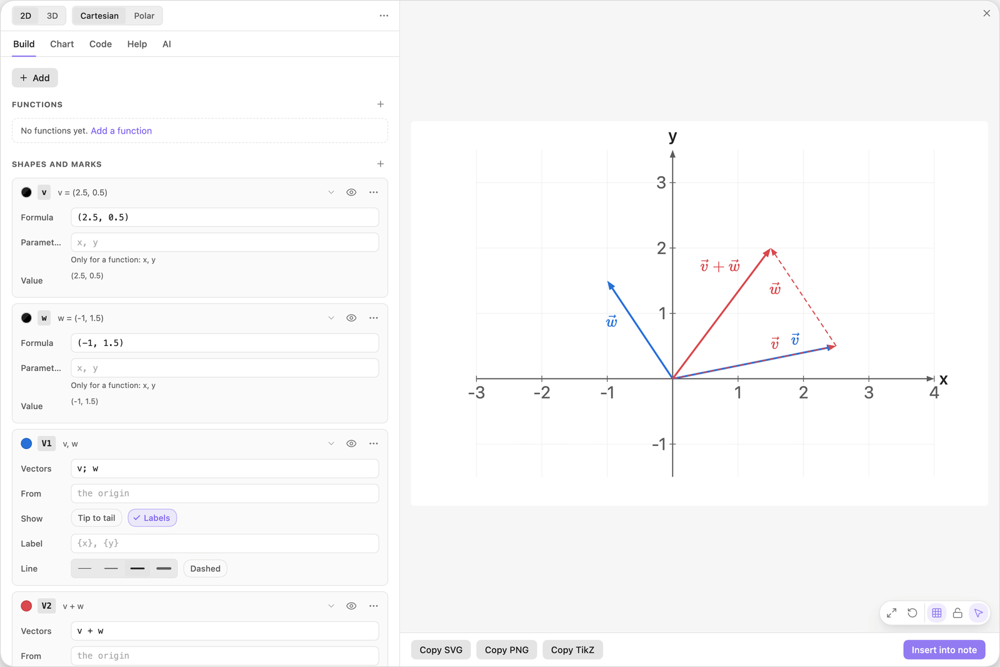
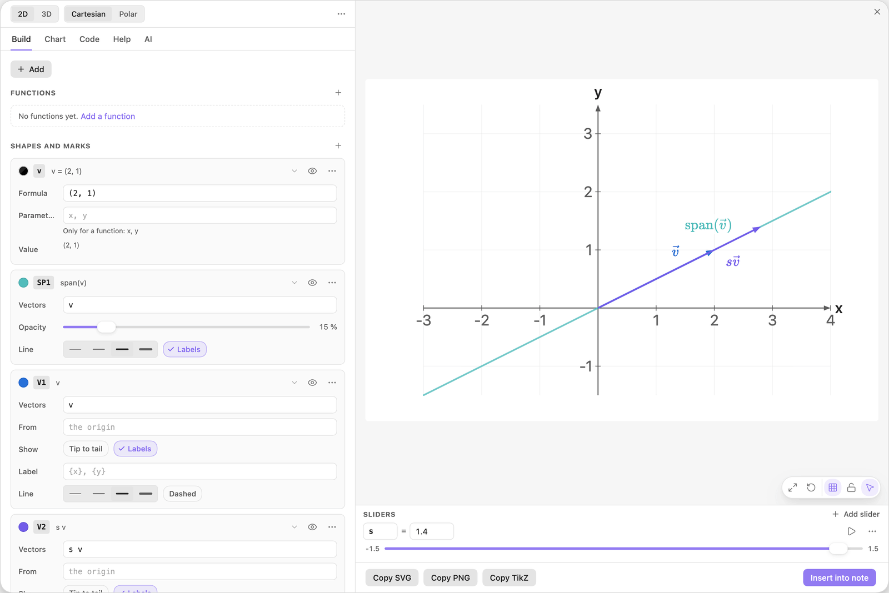

<!-- Generated by scripts/media/build-guides.mjs from src/guides. Do not edit. -->

# Vectors and arrows

[All guides](README.md) · Linear algebra and complex numbers · Start here · about 2 minutes

Name vectors with let, draw them as arrows, add them tip to tail and scale one with a slider.

<p align="center"></p>

**What you can do afterwards**

- Draw named vectors as arrows
- Add two vectors tip to tail
- Scale a vector and draw its span

**Read first:** [Vectors, matrices and complex numbers](values-let.md)

## 1. Draw two vectors as arrows

`let v = (2, 1)` gives a vector a name. `draw v and w as arrows` draws both from the origin, and `labelled` writes their names at the tips.

The chart in words:

```easy-tikz
show x from -3 to 4 and y from -1.5 to 3.5
size 12 x 8
equal scale
axes in the middle
with a grid
let v = (2, 1)
let w = (-1, 1.5)
draw v and w as arrows, labelled
```



## 2. Add them tip to tail

`draw v + w tip to tail` puts the arrow of w on the tip of v, dashed, and draws the sum from the origin to its end.

The chart gets these lines:

```easy-tikz
draw v + w tip to tail in red, labelled
```



## 3. Drag a tip to change a vector

In the editor, drag the tip of v. The numbers of its `let` line change as you drag, and the sum follows.

The chart gets these lines:

```easy-tikz
let v = (2.5, 0.5)
```



> **Tip:** This works for a vector written as plain numbers. Hold Alt for one more decimal.

## 4. Scale a vector with a slider

`s v` is v times the slider `s`. Drag `s`: the arrow grows, shrinks and turns round, but stays on the line of `draw the span of v`.

The chart gets these lines:

```easy-tikz
slider s from -1.5 to 1.5, starting at 1.4
let v = (2, 1)
draw the span of v, labelled
draw v as an arrow, labelled
draw s v as an arrow in purple, labelled
```



## The finished chart

Paste this block into a note to get the finished chart of this guide. Click the chart in the note to open it in the editor.

<details>
<summary>The chart as an easy-tikz block</summary>

```easy-tikz
show x from -3 to 4 and y from -1.5 to 3.5
size 12 x 8
equal scale
axes in the middle
with a grid
slider s from -1.5 to 1.5, starting at 1.4
let v = (2, 1)
draw the span of v, labelled
draw v as an arrow, labelled
draw s v as an arrow in purple, labelled
```

</details>

## Next guides

- [A matrix moves the plane](matrix-plane.md): Draw the grid and the basis vectors, then let a matrix move the whole plane in a step you can play.
- [Complex numbers and maps](complex-maps.md): Mark complex numbers as points, bend a grid with z ↦ z² and colour the plane by a complex function.

[All guides](README.md)
