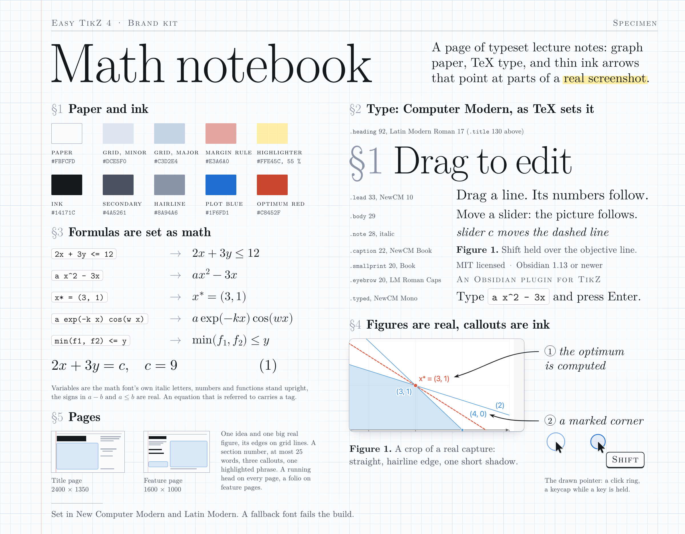

# Brand kit: "Math notebook"

The look of everything that promotes Easy TikZ 4: images, video frames, title and end cards. The plugin makes
TikZ figures, so its promotion looks like the best page of a mathematician's notebook, set in TeX.



Development only, like the rest of `scripts/media`: nothing here ships with the plugin and there are no npm
dependencies. The fonts are the TeX fonts of your own TeX Live; they are not copied into the repository.

```bash
npm run media:brand                                 # the same as node scripts/media/brand/build.mjs
node scripts/media/brand/build.mjs                  # fonts.css, tests, specimen.png, the two proofs, the font check
node scripts/media/brand/build.mjs --skip-capture   # compose again from the captures in proofs/shots
node scripts/media/brand/build.mjs --fonts          # only fonts.css: enough to open a template in a browser
node scripts/media/brand/build.mjs --only hero --out /tmp/brand --port 9371
```

## The rules

Modern here means confident scale, a lot of air, asymmetric layouts, big sharp real screenshots, precise thin
line work and one or two accents. It does not mean gradients, glass, neon or sans-serif startup type. And it
must not tip into kitsch: no paper texture, no stains, no tape, no torn edges, no handwriting fonts, no doodles.

**Paper.** Cool near-white `#FBFCFD` with a graph grid: minor lines `#DCE5F0` every unit, major lines `#C3D2E4`
every 5 units, one hairline weight everywhere. A unit is 24 px on a page 1600 px wide and scales with the page
(36 px on the 2400 px title page). One thin red margin rule `#E3A6A0`, 4 units from the left edge, is the
notebook cue. Text and figures start one unit to its right and end on line 64 (`--right` is the margin that
is left: 64 px on a 1600 px page). Behind text the grid fades softly (a mask, never a box): put `data-fade` on
the block.

A grid line is a whole number of device pixels (one, on every page of this kit), so it is crisp at every size.
The colours above are those of the title page (unit 36 px); on a smaller page one pixel is a larger part of the
page, so the lines carry less ink (unit / 36: two thirds on a 1600 px page). Shown at the same width, a feature
page and the title page then have the same paper. `paper.mjs` does this (`lineOf`); do not pass a line weight
of your own.

**The layout sits on the paper.** Place boxes in grid units and text by its baseline: `data-baseline="7"` puts
the first baseline of a block on the 7th grid line, `data-captop="9"` puts the top of its capitals there (level
with the top edge of a figure at 9). Give running text a line-height in units (`1.5 * var(--u)`) and all its
lines stand on lines of the paper. No magic decimals, and two texts that should share a baseline do.

**Edges lie on grid lines.** An edge of a figure, or a rule, that runs a few px beside a grid line reads as a
doubled line. So an edge or a rule is either ON a grid line or at least 0.4 unit away from the next one. Give a
figure a left, a top and a width in whole units and `data-rows` on its `.shot` (the crop then takes the height
that fills that many units): all four edges lie on lines, as those of the 37 x 26 figure of `card-drag` do. A
detail shown pixel for pixel has the size the app gave it: stand it on a line and end it on one
(`card-drag` ends the tip on line 24). The rule of the running head lies on line 3 (line 2 on the title page,
`--head-rule`), with the head half a unit above it. The build checks every `.fig`, every `[data-edge]` box and
every rule.

**Ink.** Text `#14171C`, secondary `#4A5261`, hairlines `#8A94A6`. Two accents, taken from the plugin's own
charts: plot blue `#1F6FD1` and optimum red `#C8452F`. One highlighter, `#FFE45C` at 55 %, may mark ONE phrase
per image. Nothing else.

**Type.** Real TeX fonts, found with `kpsewhich`:

| Use | Font | Class and size (design px on a 1600 px page) |
| --- | --- | --- |
| Title of the title page, section headings | Latin Modern Roman 17 (drawn for display sizes) | `.title` 130, `.heading` 92 |
| Text, margin notes (italic), bold labels | New Computer Modern 10 | `.lead` 33, `.body` 29, `.note` 28 |
| Captions and small print | New Computer Modern 10 Book (stronger strokes for small sizes) | `.caption` 22, `.smallprint` 20 |
| Formulas | New Computer Modern Math | `.m` (written by `math.mjs`), display equations 36 |
| What the user types | New Computer Modern Mono | `.typed` |
| Running heads, eyebrows, the keycap | Latin Modern Roman Caps | `.running-head` 20 (23 on the title page), `.eyebrow` 20, keycap 21.5 |
| Small headings | Latin Modern Roman Demi | `.subheading` 30 |

Headlines are large and tight, like the title of a paper; their first stem stands on the left edge of the text
(an optical margin, built into `.title` and `.heading`). Formulas are typeset as math: italic variables,
upright numbers and function names, real minus and inequality signs. Never set a formula as raw code, except
to show what the user types, which stays monospace. Equations that belong together are aligned on their
relation sign (`aligned()`). Running heads are capitals and small capitals: write them with their capitals
("Easy TikZ 4"), so a figure has capitals of its own height beside it; the part of a head that is news may be
set in ink (`<span class="ink">`). No synthetic bold or italic: `font-synthesis: none` is set, so a missing
face shows as a mistake instead of being faked.

An equation tag names the same thing as the same mark in the figure of that page, or it is a mark the figure
does not use. The Linear program prints (1) and (2) on its constraint lines: beside that chart a tag (1) means
constraint (1), as on the title page, and two equations about something else are tagged (a) and (b), as on
`card-drag`. A reader takes "(2)" on a line of the figure for "the line of equation (2)".

**Smallest sizes.** These images are seen small: about 800 px wide in a README, 400 px when two feature pages
stand side by side. Text that must be read (heading, body, notes, equations) is at least 1.75 % of the page
width, 28 design px: 14 px at 800. Nothing that means something is smaller than 1.2 % (19.2 design px), and the
build refuses a page that breaks this. That goes for text drawn on the overlay too: the keycap beside the
pointer is the only sign in a picture that a key is held, so its label is 21.5 design px. What follows from it:

- Feature pages go two side by side at most. At 400 px the heading is 23 px and the figure survives, the body
  does not; three side by side, only the picture survives. So the figure of a page has to tell its idea alone,
  a grid of pages is a teaser that links each picture to its full file, and where the body matters the page
  is shown on its own.
- An image that is always seen small (a social preview) sets `<body data-zoom="1.3">`: type, grid unit and
  strokes grow together.
- Only the title page may show the whole editor: at 800 px its left panel is texture, which a title page can
  carry because the chart, the notes and the sentence read. Every other image, the social images included,
  crops to a fragment and shows it large.

**Notebook devices.** Use them, they are the identity: section numbers ("§2 Sliders"), equation tags "(1)",
"**Figure 1.**" captions with a bold label and a plain sentence, margin notes in italic, footnote-style small
print, a thin top rule with the running head "Easy TikZ 4" and a folio ("3 / 8") on feature pages.

**Callouts.** TikZ-style: a thin ink arrow (1.75 px on a 1600 px page) with a stealth tip, gently curved, from
a margin note to the exact spot on the real screenshot. At most three per image, each note a few words.

- One exit for all: an arrow leaves its note horizontally at the note's left (or right) end, `out: 180`, and
  arrives with a slight curve (`in:` the side it comes from). No humps, no arrow that starts under a word.
- No canes. An arrow that leaves sideways and then has a long way down turns all at once, like the crook of a
  cane. Give it room to turn: a shorter note starts it further out (on `card-drag`, "the pivot" instead of a
  sentence the body already says), or a longer first handle spreads the bend (`looseness: [1.4, 0.7]`).
- Aim at free ground. Choose the spot and the side of arrival so that the tip stands clear of every other line
  and label: an arrowhead in the wedge between two lines points at both, and a tip that stops just under the
  label of another line points at that label (the sheet's second callout comes in under the end of line (2)
  for that reason). Where the shaft has to cross lines of a chart, case it (`over: '#figure'`): a white
  under-stroke inside the figure, so it lies on top of them, and leave at least 20 design px of run between
  the crossing and the tip.
- The pointer's keycap needs free ground as well: `keycapSize()` says how large it is, `keycapOffset` moves it
  (`card-drag` finds the white wedge between two lines of the chart).
- The note is true of the exact thing the tip touches. "Drag this line: its formula follows" belongs on a
  constraint line (the drag rewrites its condition), not on the objective line (a plain drag moves slider `c`
  and leaves the text alone). Act the claim out in the capture script before you print it.
- An enlarged detail (TikZ: `spy`) is a figure of its own with a hairline edge, shown pixel for pixel
  (`data-native`), joined to its spot by one level line. No second frame around a spot that has an edge.

**Figures.** Real captures only (light theme, the 3456 px full screen source). Crop boldly and show UI
fragments large: a figure whose text cannot be read at README width fails. Straight, corner radius 10 px on a
1600 px page (a crop of the whole editor takes the editor's own radius), hairline edge, one soft shadow: a
contact line and a short drop that has ended one unit under the figure. Keep a caption at least 1.25 units
clear of a figure's edge (its baseline 2 units under it) and small print 2 units: they stand on clean paper.
Never enlarge a capture above 100 %: the build refuses. Tidy the app before the shot, with real input: no
empty state as the first words, no card cut in half by the edge of the picture.

**Density.** A feature page carries the heading, the body, the figure with its caption and ONE secondary block
(equations, or an enlarged detail), with at most three callouts, two when a detail is present. The proof page
`card-drag` has both blocks because its brief asks for both: it is the ceiling, not the model.

**Voice.** Short declarative sentences, like a good textbook. "Drag the line. Its numbers follow." No hype.
Every sentence and number in an image is true of the plugin today, and says something to a reader who has
never seen the plugin: a caption names what is shown ("The redesigned editor, on the Linear program example"),
not how the picture was made. What is new belongs in the sentence everybody reads, not only in the small type:
the title page says "now edited by dragging" in its lead and marks it. Break short texts by hand so that the
rag tapers (long, shorter, shortest), never short over long.

**Limits the build checks.** At most three callout arrows and one highlighted phrase per page, no em dash, no
text off the page, no text under 1.2 % of the page width (the overlay's text included), no enlarged capture, no
edge or rule that runs beside a grid line, and every glyph drawn with a TeX font.

## Files

| File | What it is |
| --- | --- |
| `brand.css` | Tokens (custom properties) and the classes: page, running head, title, heading, lead, body, note, caption, small print, typed, highlighter, math, equation, aligned equations, figure, detail, overlay |
| `fonts.mjs` | Finds the fonts with `kpsewhich`, writes `fonts.css` (generated, not committed), checks a rendered page for fallback fonts |
| `paper.mjs` | `paperSVG()`: the grid, the margin rule and the fades as one SVG of exact size; `lineOf()`: weight and ink of a line for a unit |
| `callout.mjs` | `callout()`: a curved arrow between two points with a stealth tip, `looseness` (one number or `[out, in]`) for the length of its handles, `casing` for crossing chart lines, `progress` 0..1 for a draw-on animation; `spy()`: the link from an enlarged detail to its spot (one level line, or `link: 'zoom'` for two projection lines) |
| `math.mjs` | `math()`, `equation()`, `aligned()`, `mathText()`: plain input such as `2x + 3y <= 12` to typeset spans |
| `pointer.mjs` | `pointer()`: the drawn arrow pointer, a click ring, a held ring, a keycap badge (`keycapSide`, `keycapOffset`); `keycapSize()`: how large the badge is |
| `page.mjs` | In-page glue: `ready()` sizes the page (and its right margin), loads the fonts, typesets, puts text on the grid, crops the captures, mounts the paper, checks the limits |
| `render.mjs` | `renderPage()`: a template to a PNG of exact size, with the checks above and crops resampled once by ImageMagick |
| `build.mjs` | Builds the specimen, the proofs and the font check |
| `specimen.html`, `specimen.png` | The brand sheet |
| `fontcheck.html` | Every face beside the system fallback, to see that the TeX fonts are in use |
| `proofs/` | `capture.mjs` (real captures and where things sit in them), `hero.html`, `card-drag.html`: start a new image from these |
| `math.test.mjs` | The formatter on the formulas of the media: `node scripts/media/brand/math.test.mjs` (also run by `npm test`) |
| `kit.test.mjs` | The paper's lines, the callout curve and the pointer's keycap: `node scripts/media/brand/kit.test.mjs` (also run by `npm test`) |

## A page

Sizes in `brand.css` are design px for a page 1600 px wide, multiplied by `--k`. `page.mjs` sets `--W`, `--H`
and the grid unit `--u` (a whole number of px) from the body's `data-width` and `data-height`, so the same
classes serve a 1600 x 1000 page, the 2400 px title page and a 1920 px video stage. Place things in grid units:
the layout then sits on the paper.

```html
<body class="page" data-width="1600" data-height="1000">
  <div class="running-head"><span>Easy TikZ 4</span><span class="folio">2 / 8</span></div>
  <h1 class="heading abs" style="left: var(--left)" data-baseline="8" data-fade="0.45"><span class="secno">§2</span>Sliders</h1>
  <p class="body abs" id="text" style="left: var(--left); width: calc(19 * var(--u)); line-height: calc(1.5 * var(--u))" data-baseline="11" data-fade="0.4">Type a new name. One click makes it a slider.</p>
  <figure class="fig abs" id="dock" style="left: calc(27 * var(--u)); top: calc(10 * var(--u)); width: calc(37 * var(--u))">
    <div class="shot" data-shot="surplus-2" data-rect="stage" data-rows="26"></div>
  </figure>
  <p class="caption abs" style="left: calc(27 * var(--u))" data-baseline="38" data-fade="0.4"><b>Figure 1.</b>The Sliders dock under the preview.</p>
  <p class="note abs" id="n1" style="left: var(--left)" data-baseline="30" data-fade="0.4">the thumb you drag</p>
  <script src="shots/meta.js"></script>
  <script type="module">
    import { ready } from '../brand/page.mjs';
    await ready({ meta: window.SHOTS, shots: 'shots/' }, ({ fig, anchor, arrow, k }) => {
        arrow({ from: anchor('#n1', 'right', { dx: 14 * k }), to: fig('#dock').point('sliderThumb'), out: 0, in: 200, gap: 10 * k });
    });
  </script>
</body>
```

- `.abs` boxes are placed in grid units; text by `data-baseline` or `data-captop` (grid lines from the top).
- `.shot` crops a capture: `data-shot` (a name in the metadata), `data-rect` (a recorded rectangle such as
  `editor` or `stage`, or `x,y,width,height` in CSS px of the captured window), `data-pad`, `data-radius`.
  The figure keeps its CSS width and its height follows the crop. `data-rows="26"` makes it exactly 26 units
  high instead: the crop grows or shrinks about its middle (`data-rows-anchor="top"` or `"bottom"`: from that
  edge), so the lower edge lies on a grid line as well. With `data-native` the figure takes the size of the
  crop and shows it pixel for pixel (an enlarged detail).
- `data-math` typesets the element's text (`data-tag="1"` makes it a display equation with its tag).
  `data-value="turn.after.c"` prints a value of the metadata: numbers in an image come from the app.
  `aligned([[input, tag], { inter: html }, ...])` of `math.mjs` sets equations aligned on their relation sign.
- `data-fade="0.4"` fades the grid behind the block to 40 % of its ink.
- In `ready()`'s function: `fig(sel).point(nameOrXY)` and `.rect(name)` map a spot of the captured window to
  page px; `anchor(el, side, { dx, dy, line })` is a point on the edge of a text block; `arrow()` (with
  `over: '#figure'` where it crosses chart lines), `spy()`, `pointer()` and `draw()` put ink on the overlay.
  The metadata shape is the one `proofs/capture.mjs` writes:
  `{ view, shots: { name: { file, width, height, rects, points, texts, pivot, pointer, radius, radii } } }`.
- `<body data-zoom="1.3">` enlarges everything the kit sizes; `data-min-text="0.9"` lowers the size check for a
  reference sheet that is read at full size (the specimen), never for an image of the README.
- The running head: `<div class="running-head"><span>Easy TikZ 4</span><span class="folio">2 / 8</span></div>`.
  Its rule lies on grid line `--head-rule` (3; the title page sets 2) and its last child ends on the right
  margin. `ready()` sets `--right` so that the text area ends on the last grid line that leaves 2.5 units
  (`<body data-right="3">` for another margin, in units). `data-edge` on any other box with an edge puts it
  under the check of edges and grid lines.

Render it:

```js
import { launchChromium } from '../lib/chromium.mjs';
import { renderPage, optimisePng } from '../brand/render.mjs';

const chrome = await launchChromium({ port: 9372 });
try {
    await renderPage(chrome, 'scripts/media/promo/card-sliders.html', 'docs/media/card-sliders.png', { width: 1600, height: 1000, shotsDir: 'scripts/media/promo/shots' });
    optimisePng('docs/media/card-sliders.png');
} finally {
    await chrome.close();
}
```

`renderPage` writes `fonts.css` if needed, waits for `ready()`, replaces every capture by a crop that
ImageMagick resampled once (Lanczos) to exactly the device pixels it covers, and fails with a list when the
page reports a problem or a glyph is drawn with a font that is not one of the brand's. Then look at the
picture, also 800 px wide (`magick out.png -resize 800x small.png`) and, for a feature page, 400 px wide:
headline, body and the key part of the figure must still read at 800, the headline and the figure at 400.

## In a video

The modules are plain functions that return strings, so a stage page can call them for every frame:

```js
import { paperSVG } from '../brand/paper.mjs';
import { callout } from '../brand/callout.mjs';
import { pointer } from '../brand/pointer.mjs';
import { math } from '../brand/math.mjs';

stage.insertAdjacentHTML('afterbegin', paperSVG({ width: 1920, height: 1080 }));        // once: unit 29 px, margin rule
overlay.innerHTML =
    callout({ from: [1500, 420], to: [1180, 610], out: 180, in: 20, width: 2.1, progress: t / 0.4 }).svg +   // draws on in 0.4 s
    pointer({ x, y, scale: 1.6, ring: clickAge / 0.45, keycap: shiftDown ? 'Shift' : '' });        // keycap label 26 px: write 'Shift' with its capital
caption.innerHTML = `§3 The formula follows: ${math('2.5x + 3y = c')}`;
```

Set `--W: 1920` on `:root` (or give the body `data-width` and call `ready()`), and every class of `brand.css`
has the right size: a caption in `.lead` is 40 px, the callout weight is `1.75 * 1.2`. The stage's grid is one
pixel wide at 80 % of its colours (`lineOf(29)`): the same paper as the images.

## The proofs

`proofs/capture.mjs` takes four pictures of the Linear program example in the isolated Obsidian of the media
toolkit (full screen size, light theme): the editor, Shift held over the objective line (hover tip and pivot
ring), the Shift-drag held in the middle, and the chart after it. It also records what the app reported: the
tip's text, and the equation and slider before and after the drag (`2x + 3y = c`, `c = 9` becomes
`2.5x + 3y = c`, `c = 10.5` when the line is grabbed at (1.5, 2), where the pointer rests in the picture, and
released at (1.5, 2.25)). The proofs print those values; nothing in them is typed from memory. The title page
prints the condition of constraint (1) the same way, as equation (1) under its first note.

Two more things the capture does so that the proofs are true and tidy:

- It acts out the title page's first note: a real drag of constraint line (1) from (1, 3) to (1, 3.5) turns
  the condition `x + y <= 4` into `x + y <= 4.5`, and undo puts it back. If the app stops doing that, the
  build fails instead of printing a claim that is no longer true.
- It tidies the Build panel for the title page with real input: the cards C1 and P2 are collapsed by a click
  on their headers (their one-line summaries stay) and the list is scrolled to its end with the wheel. "Shapes
  and marks" then leads instead of the empty Functions section, and the list ends with the whole P1 card
  instead of a card cut in half by the editor's edge.

Two things to know when you script a Shift-hover. The editor hears the Shift key on its own element: in a
session where nothing in the editor has the keyboard focus yet, press Shift before the pointer arrives
(`await obs.keyDown('Shift')`, then `obs.hover(...)`), so the pointer events carry it. And now and then the
tip does not show, or the tip of another shape answers, although the pointer rests on the line (two of seven
runs on the day this was written; the cause is not known). `capture.mjs` therefore reads the tip, and when it
is not the expected one it logs what it saw, lets go and hovers again, at most three times. The picture is
taken only when the tip is right and the pointer is on the line.
